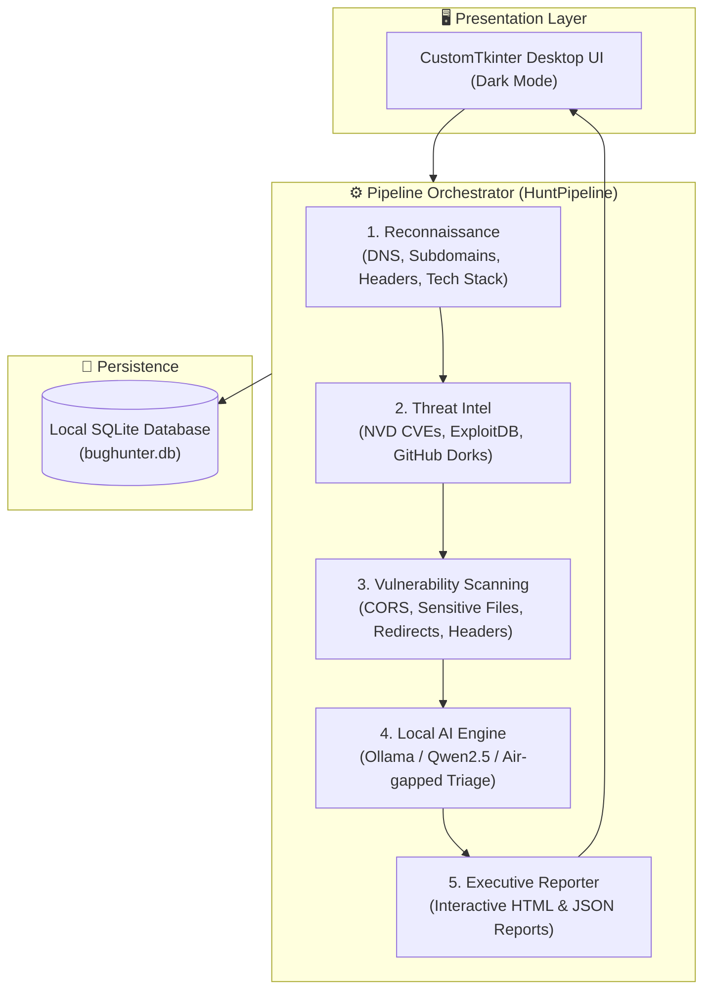

# BugHunter AI 🛡️🤖
### Autonomous AI-Assisted Security Reconnaissance, Threat Intel & Vulnerability Scanner

[](https://www.python.org/)
[](https://github.com/TomSchimansky/CustomTkinter)
[](https://ollama.ai/)
[](https://sqlite.org/)
[](LICENSE)

**BugHunter AI** is a professional desktop security workstation engineered for security researchers, ethical hackers, and bug bounty professionals. It pairs automated reconnaissance, exploit intelligence aggregation, and vulnerability scanning with **local, air-gapped Large Language Models (LLMs via Ollama)** to triage vulnerabilities, eliminate false positives, and formulate executive remediation reports.

---

## 🚀 Key Highlights & Architectural Strengths

- **🔒 100% Local & Sovereign AI Intelligence**:
  - Leverages local LLMs (e.g., `qwen2.5:7b`, `dolphin-llama3`) via **Ollama** (`http://localhost:11434`).
  - Analyzes target attack surfaces, crafts custom validation test vectors, and evaluates real-world exploitability **without transmitting sensitive target hostnames or reconnaissance data to third-party cloud APIs**.
- **🌐 End-to-End Orchestrated Pipeline**:
  - Executes a structured multi-phase workflow: **Reconnaissance ➔ Exploit/CVE Intel ➔ Vulnerability Probing ➔ AI Triage ➔ Interactive Reporting**.
- **⚡ Multi-Threaded Recon & Security Probes**:
  - High-throughput DNS discovery, WHOIS extraction, HTTP security header audits, CORS misconfiguration testing, sensitive file/directory disclosure, and open redirect detection.
- **🔎 Real-Time Threat Intel Aggregation**:
  - Live query integration across **NVD CVE databases**, **ExploitDB**, and security repositories to correlate target technologies with known public exploits.
- **🎨 Modern Dark-Mode GUI (CustomTkinter)**:
  - Ergonomic, responsive desktop interface featuring real-time hunt logs, phase progress trackers, categorized finding tables, and session management.
- **📊 Executive Delivery Reports**:
  - Automatically compiles audit results into standalone, beautifully-rendered **HTML & JSON executive reports** ready for bug bounty submissions or client deliverables.

---

## 🏗️ System Architecture



---

## 📦 Project Structure

```
bughunter-ai/
├── gui/
│   ├── app.py                 # Primary CustomTkinter interface
│   ├── simple_app.py          # Streamlined high-performance UI runner
│   └── __init__.py
├── modules/
│   ├── recon/                 # DNS, WHOIS, Subdomain & Header profiling
│   │   └── recon.py
│   ├── intel/                 # CVE and Exploit intelligence sources
│   │   ├── nvd_cve.py
│   │   ├── exploitdb.py
│   │   └── github_search.py
│   ├── scanner/               # Multi-threaded vulnerability assessment checks
│   ├── ai_engine/             # Local Ollama integration & prompt engineering
│   │   └── engine.py
│   ├── pipeline.py            # Automated multi-phase hunt orchestrator
│   └── reporter.py            # HTML/JSON export generator
├── db/
│   ├── database.py            # SQLite session and finding management
│   └── __init__.py
├── config.py                  # Default system settings and scanner thresholds
├── requirements.txt           # Python dependencies
├── launch.bat                 # One-click Windows launcher
└── main.py                    # Main desktop application entry point
```

---

## 🛠️ Quick Start

### 1. Prerequisites
- **Python 3.10+**
- **Ollama** installed and running locally:
  ```bash
  # Start Ollama daemon and pull recommended local security model
  ollama run qwen2.5:7b
  ```

### 2. Installation
Clone the repository and install required Python packages:

```bash
git clone https://github.com/your-username/bughunter-ai.git
cd bughunter-ai

# Create virtual environment (recommended)
python -m venv venv
venv\Scripts\activate      # On Windows
# source venv/bin/activate  # On Linux/macOS

# Install dependencies
pip install -r requirements.txt
```

### 3. Launching the Application
Execute the desktop workstation directly:

```bash
python main.py
```
*Or double-click `launch.bat` on Windows.*

---

## ⚙️ Configuration

Settings can be customized via `config.py` or configured inside the application settings panel:
- **`ai_provider`**: Default `ollama` (Zero cloud dependency). Supports `gemini` or `openai` as optional fallbacks.
- **`ollama_model`**: `qwen2.5:7b` (recommended balance between reasoning precision and execution speed).
- **`threads`**: Concurrency level for active network requests (default: `10`).
- **`timeout`**: Request timeout in seconds.
- **`user_agent`**: Customizable User-Agent header for audit logging and bug bounty platform identification.

---

## ⚖️ Responsible Use & Legal Disclaimer

> **DISCLAIMER:**  
> BugHunter AI is developed solely for authorized security assessments, penetration testing, educational research, and bug bounty programs conducted under explicit authorization. Scanning targets without prior mutual written consent is illegal. The authors accept no liability for misuse, damages, or violations caused by this tool. Always practice responsible disclosure.

---

## 📄 License

This project is licensed under the [MIT License](LICENSE).
